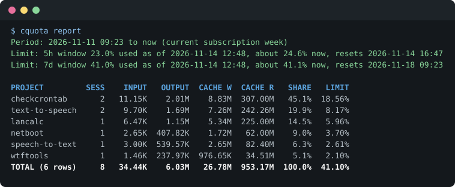
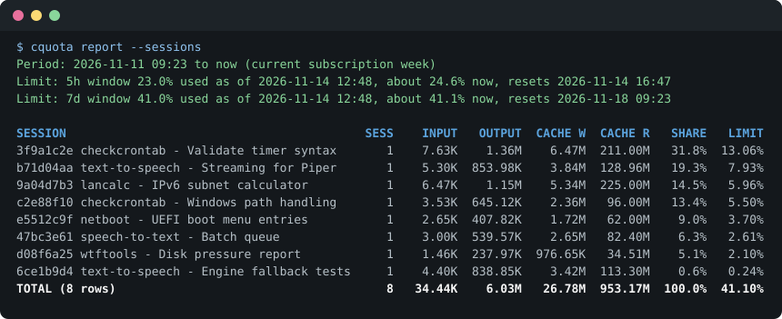
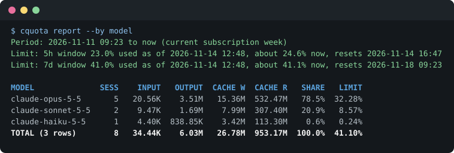
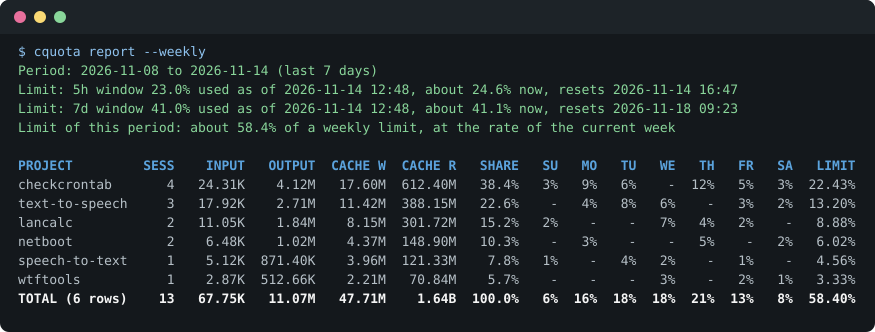
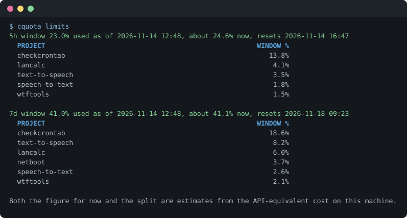
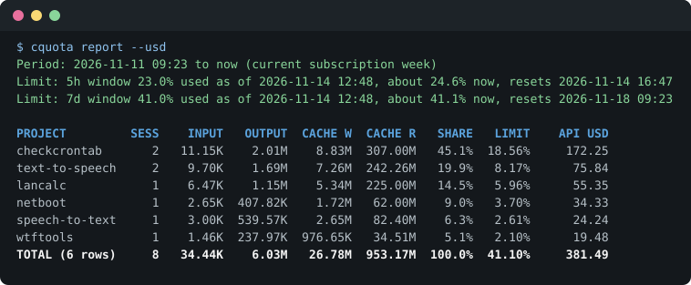

# cquota

**See where your Claude Code subscription goes: tokens and limit share by
project and by session.**

A subscription has no bill to read, so the only question that matters is hard
to answer: which project ate the week? cquota keeps a local ledger of
every API response Claude Code makes and turns it into a report.



## Features

- **By project and by session** - the project is the directory a session was
  launched from, the session is shown with its title
- **Tokens and percentages** - input, output, cache write and cache read
  apart, plus the share of the period and the share of the weekly limit
- **The subscription week by default** - the report covers the current limit
  window and says how much of it is used
- **Nothing lost** - subagents and workflow agents are counted, streaming
  duplicates and resumed sessions are counted once
- **Outlives the transcripts** - history is kept in one SQLite file after
  Claude Code cleans its transcripts up
- **Table or JSON** - for reading or for scripts
- **No dependencies** - Python 3.12 standard library, everything stays on
  your machine

## Install

As a Claude Code plugin:

```
/plugin install cquota --marketplace wachawo/cquota
```

The plugin keeps the ledger current by itself. Its hooks run the ingest in
the background after every turn and every subagent, and at both ends of a
session. A hook that did not fire loses nothing: the next run reads whatever
the transcripts gained in the meantime.

From a local checkout:

```bash
claude plugin marketplace add /path/to/cquota
```

```bash
claude plugin install cquota@cquota
```

Or without installing anything, straight from a clone:

```bash
bin/cquota ingest
```

The first run reads the whole history, every later run reads only what was
appended since.

## Usage

Inside a Claude Code session:

```
/cquota:report
```

From a shell, the current subscription week needs no options. Bring the
ledger up to date first, so the report includes what was spent since the last
hook ran:

```bash
bin/cquota ingest --quiet
```

```bash
bin/cquota report
```

### By session

```bash
bin/cquota report --sessions
```



### By model

```bash
bin/cquota report --by model
```



### By day of the week

```bash
bin/cquota report --weekly
```



The last 7 days, today included, with one column per day. Add `--week` for
the days of a subscription week instead.

### As JSON

```bash
bin/cquota report --json
```

```json
{
  "by": "project",
  "period": {
    "source": "current subscription week",
    "limit_used": 41.1,
    "since_local": "2026-11-11 09:10"
  },
  "limits": {
    "seven_day": {
      "label": "7d",
      "used_percentage": 41.0,
      "as_of": "2026-11-14 12:35",
      "estimated_percentage": 41.1,
      "resets_at": "2026-11-18 09:10"
    }
  },
  "rows": [
    {
      "key": "/home/dev/projects/checkcrontab",
      "label": "checkcrontab",
      "sessions": 2,
      "input_tokens": 11153,
      "output_tokens": 2008791,
      "cache_write_5m_tokens": 0,
      "cache_write_1h_tokens": 8828486,
      "cache_read_tokens": 307000000,
      "api_usd": 172.25,
      "share_percent": 45.15,
      "limit_percent": 18.56
    }
  ]
}
```

The output above is shortened. The JSON carries the period, the limit
windows, every row with exact token counts and the total.

```bash
bin/cquota --version
```

### Options

| Option | Meaning |
|---|---|
| `--by` | `project` (default), `session`, `day` or `model` |
| `--sessions` | short for `--by session` |
| `--week` | subscription week to cover, as weeks back: `0` or `this` (default), `1` or `last`, `2` and so on |
| `--weekly` | add a column per day; covers the last 7 days unless `--week` is given, not combined with `--since`, `--until` or `--all` |
| `--since`, `--until` | inclusive range of local days, `YYYY-MM-DD` |
| `--all` | the whole history |
| `--project` | only projects whose path contains the text |
| `--full-paths` | show projects by full path instead of by directory name |
| `--usd` | add the API-equivalent cost as the last column |
| `--format` | `table` (default) or `json` |
| `--json` | short for `--format json` |
| `--limit` | rows to show, 20 by default, 0 for all; the total always covers every row |

```bash
bin/cquota report --sessions --week last --json --limit 0
```

```bash
bin/cquota report --by day --since 2026-11-01 --until 2026-11-07
```

## Reading the report

| Column | Meaning |
|---|---|
| `SESS` | sessions that contributed to the row |
| `INPUT` | fresh input tokens |
| `OUTPUT` | output tokens, thinking included |
| `CACHE W` | tokens written to the prompt cache |
| `CACHE R` | tokens read from the prompt cache |
| `SHARE` | part of the period this row accounts for, by API-equivalent cost |
| `MO` ... `SU` | part of the period this row spent on that day; shown with `--weekly` |
| `LIMIT` | part of the weekly subscription limit this row used |
| `API USD` | what the same usage would cost at the list prices of the API; shown with `--usd` |

A week is the weekly subscription window when its reading is known, so that
the report and the limit describe the same usage; otherwise it is the
calendar week from Monday.

`SHARE` stays relative to the whole period when the report is narrowed to one
project. `LIMIT` is the used percentage of the window, as estimated for now,
times the share. It is an estimate.

A period without a limit reading of its own - the last 7 days, an earlier
week nobody recorded, a range of days, the whole history - is priced at the
rate of the current week: its API-equivalent cost per percent of the limit.
`LIMIT` is then in percent of one weekly limit, so a long period can come to
more than 100%, and a line above the table says so.

The day columns of `--weekly` split `SHARE` between the local days of the
period, oldest first: the cells of a row add up to its `SHARE`, those of the
total to 100%, and `-` marks a day without usage. A subscription week that
starts in the middle of a day touches 8 calendar days and gets 8 columns.
The JSON output carries the same as `days` and, per row, `day_percents`.

A project is the directory a session was launched from, whatever directories
it moved to afterwards. A git worktree counts as its main repository. Two
projects with the same directory name get their parent directory added.

## Subscription limits



Claude Code tells only its status line how much of the 5 hour and 7 day
windows is used, and a plugin cannot set the status line. This part is
switched on by hand in `~/.claude/settings.json`:

```json
"statusLine": {
  "type": "command",
  "command": "python3 /path/to/cquota/bin/cquota statusline"
}
```

The status line then shows `5h 23% - 7d 41%` and every new reading is stored
in the ledger.

```bash
bin/cquota limits
```

prints the current windows and splits the used share of each between
projects.

A reading is only as fresh as the last API response of the session that
reported it, and the desktop app reports none. Reports therefore say when a
reading was true and add an estimate for now, scaled by how much the
API-equivalent cost in the window grew since that moment. A turn in any
terminal session replaces the estimate with a real reading. A lower
percentage arriving from an idle session is ignored, since within one window
the figure only grows.

The split between projects is an estimate too: usage from another device or
from the chat apps counts against the limit but is attributed to local
projects.

## API-equivalent cost

A subscription has no per-token bill, so the API-equivalent cost is not
money spent. It is what the same usage would have cost at the list prices of
the API, and it is the one figure that makes projects comparable: the token
classes differ in weight, a cache read is priced far below an output token.
The shares in the report are computed from it.

The figure itself is hidden by default. `--usd` adds it as the last column,
both to `report` and to `limits`; the JSON output always carries it as
`api_usd`.

```bash
bin/cquota report --usd
```



The prices live in `cquota/prices.json` and are dated there. A model
missing from that file is left out of the cost and named under the table.
Fast mode and the long-prompt tier of the smallest model are not priced
separately.

## How it works

Claude Code writes the usage of every API response into its session
transcripts under `~/.claude/projects/`. cquota reads those files
incrementally, remembering how far it got in each one, and keeps one row per
API response in `~/.local/share/cquota/ledger.db`.

- One response is written as several transcript lines; they are folded by
  `(message id, request id)`.
- A resumed session copies the earlier history into its own transcript; a
  copied response stays with the session that made it.
- Subagents and workflow agents write their own transcripts next to the
  session's; they are read too and counted towards the session.

The ledger is a plain SQLite file and can be queried directly.

## Configuration

| Variable | Default | Purpose |
|---|---|---|
| `CLAUDE_CONFIG_DIR` | `~/.claude` | where Claude Code keeps `projects/` |
| `CQUOTA_DATA_DIR` | `~/.local/share/cquota` | where the ledger is stored |

## Limitations

- Helper requests Claude Code makes outside the conversation are not written
  to the transcripts and are not counted; they are a negligible share.
- The transcript format is internal to Claude Code and may change between
  releases; a release that changes it can require an update here.
- Limit readings come only from the terminal interface, only for
  subscribers, and only after the first reply of a session.

## Requirements

Python 3.12, standard library only. Linux and macOS.

See [CHANGELOG.md](CHANGELOG.md) for what changed.

## License

[Apache-2.0](LICENSE)
